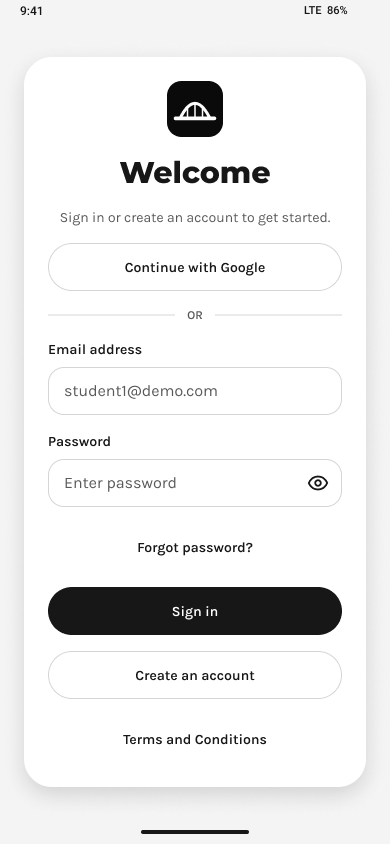
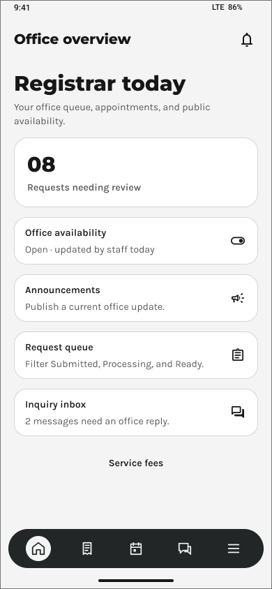
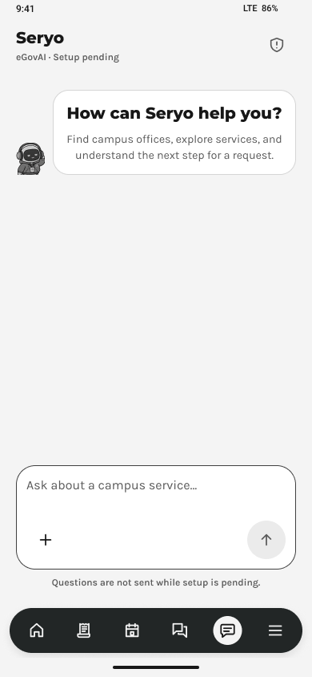
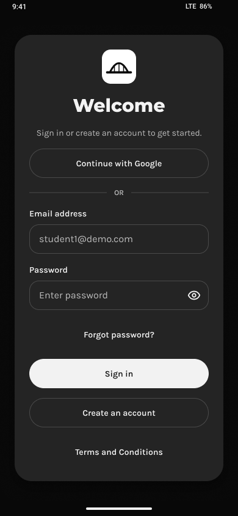
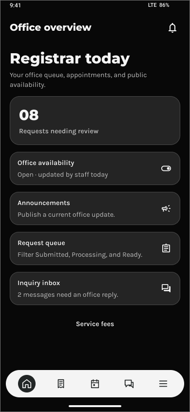
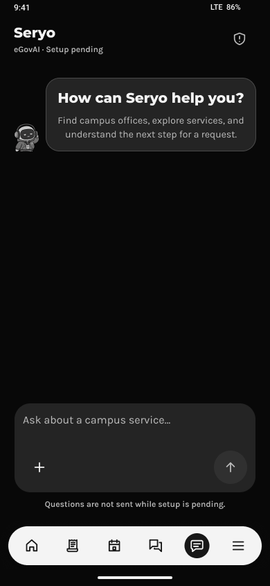

# GoServe

A native Android application for campus service requests, office communication and document delivery. GoServe connects students with campus offices and includes Seryo, an assistant focused on the application's services.

**Current version:** `2.3-test` · **Android:** 8.0/API 26 and later · **Release:** supervised testing

## Figma UI Preview

UI designed in Figma by the project author. These exports come from the **GoServe • Android v2.1** design page and show the light and dark themes.

| Sign In | Office Overview | Seryo |
| --- | --- | --- |
| <a href="https://www.figma.com/design/SvT9gBUFjdLgbrJ80LPDno/GoServe?node-id=19-2"></a> | <a href="https://www.figma.com/design/SvT9gBUFjdLgbrJ80LPDno/GoServe?node-id=24-131"></a> | <a href="https://www.figma.com/design/SvT9gBUFjdLgbrJ80LPDno/GoServe?node-id=24-51"></a> |
| <a href="https://www.figma.com/design/SvT9gBUFjdLgbrJ80LPDno/GoServe?node-id=36-2"></a> | <a href="https://www.figma.com/design/SvT9gBUFjdLgbrJ80LPDno/GoServe?node-id=36-899"></a> | <a href="https://www.figma.com/design/SvT9gBUFjdLgbrJ80LPDno/GoServe?node-id=36-819"></a> |

The counts, example account and setup labels above are design content. The implementation includes later account, recovery and UI revisions described in the [release report](docs/GoServe-Revision-Delivery-2026-10-25.md).

[Open The Figma Design](https://www.figma.com/design/SvT9gBUFjdLgbrJ80LPDno/GoServe?node-id=14-2)

## Features

- **Student services:** browse office services, submit requests and supporting documents, track progress, arrange consultations and receive document deliveries or pickup instructions.
- **Office workspaces:** review assigned requests, handle inquiries, manage office availability and publish service information. The demonstration roles cover Registrar, Accounting, Tellering, Guidance and the CCS Secretary.
- **Seryo:** GoServe service guidance with a separate consent flow, animated mascot, attachment/camera controls and server-side input/output checks.
- **Accounts:** TIP Google sign-in, existing email/password sign-in, editable profile information, profile photos and recovery-code password reset.
- **Payments:** eGovPay checkout and payment verification in TEST MODE.
- **Interface:** light/dark appearance, icon-only capsule navigation, button press feedback and a mascot-free branded loading screen.

The CCS student's department contact is the CCS Secretary. Access to records and actions depends on the authenticated account's trusted role and office or department assignment.

## Technology

| Area | Implementation |
| --- | --- |
| Android client | Java, XML layouts and ViewBinding |
| Build | Gradle 8.9, Android Gradle Plugin 8.7.3 |
| Android SDK | Compile/target API 35; minimum API 26 |
| Java | Source level 17; JDK 21 used for verification |
| Backend | Supabase Auth, PostgreSQL, Row-Level Security, Storage and Edge Functions |
| Backend checks | Node.js tests and PGlite SQL assertions; Node.js 24 used for verification |

## Repository Structure

```text
GoServe/
├── android/                 Native Android project and client tests
├── backend/
│   ├── functions/           Supabase Edge Function entry points
│   ├── lib/                 Shared validation and service logic
│   ├── migrations/          Database schema and access-control changes
│   ├── recovery-rollout/    Recovery activation and rollback instructions
│   └── tests/               Backend and SQL checks
├── docs/
│   ├── assets/figma/        Figma UI exports used by this README
│   ├── legal/               Versioned Terms and privacy documents
│   └── superpowers/         Design decisions and implementation plans
└── scripts/                 Build and controlled verification helpers
```

## Run In Android Studio

1. Open the **`android`** directory in Android Studio.
2. Select a compatible Gradle JDK, such as JDK 17 or 21. Gradle 8.9 must not use JDK 25.
3. Configure the local Android SDK path and install SDK Platform 35 if it is not present. Preserve an existing `local.properties` configuration.
4. Allow Gradle sync to finish. Select the `app` configuration and an Android API 26-or-later device or emulator, then choose **Run**.

The client already has a public Supabase configuration. To point a separate checkout at another project, copy [android/goserve.properties.example](android/goserve.properties.example) to `android/goserve.properties` and set `SUPABASE_URL` and `SUPABASE_PUBLISHABLE_KEY`.

Keep service-role keys, OAuth client secrets and provider credentials on the server. Local configuration, credentials, APKs, caches and build outputs are excluded by [.gitignore](.gitignore).

For workstation setup and the first dependency download, see [Android Setup](android/README.md#build-setup).

### Build An APK

In Android Studio, choose **Build → Generate App Bundles or APKs → Generate APKs**. The debug APK is written to:

```text
android/app/build/outputs/apk/debug/app-debug.apk
```

The verified 25 October 2026 build was also copied locally to `output/android/GoServe-v2.3-test-2026-10-25.apk`. That generated directory is not committed to Git.

## Account And Recovery Flow

New student registration requires a verified Google account whose email domain is exactly **`tip.edu.ph`**. Continue With Google remains available in both themes. Existing and provisioned demo accounts can still use email/password sign-in.

Before protected app access, a participant accepts the current Terms, completes any required profile information and explicitly saves a set of **ten unique, account-bound recovery codes**.

- Codes are single-use. Plaintext appears only when a set is generated; the backend stores digests.
- **More → Account → Recovery Codes** shows the remaining count and a protected Regenerate action. Regenerating revokes the previous unused set.
- **Forgot Password** and **Change Password** use the account email and a saved recovery code. Ordinary sign-in follows a confirmed password reset.
- Using the last code requires a replacement set before returning to protected app screens.
- App recovery does not require SMTP, TOTP, Google Authenticator or another authenticator app.

Demo login identifiers are listed in the [release report](docs/GoServe-Revision-Delivery-2026-10-25.md#demo-accounts). Passwords and generated recovery codes are not published in this README. Demo addresses are test login identifiers, not email inboxes.

## Backend Setup

The backend is deployed to Supabase. This repository contains its migrations and Edge Function source; it is not a standalone Node.js API server.

For a separate environment, follow the [deployment guide](backend/DEPLOYMENT-v2.3.md), inspect existing migration history and configure server-side secrets directly in Supabase. Review the [recovery rollout order](backend/recovery-rollout/README.md) before enabling recovery readiness. Do not replay the baseline schema over an existing project.

The client uses a publishable key. Protected operations validate the caller and apply role, ownership, session and readiness checks. Seryo uses fixed server operations rather than model-generated SQL, and its provider input excludes private account records, credentials and selected file bytes. These controls do not constitute a guarantee against every possible data leak.

## Verification

From the repository root:

```powershell
npm ci --prefix backend
npm test --prefix backend
```

Once Android tools and dependencies are cached, the local launcher runs native unit tests, debug assembly and lint:

```powershell
# Replace this path with your installed compatible JDK.
powershell -NoProfile -File scripts/build-android.ps1 -JavaHome 'C:/Tools/jdk-21'
```

The launcher uses cached dependencies offline. See [Android Setup](android/README.md#build-setup) for a new workstation.

Verified checkpoint on **25 October 2026**:

| Check | Result |
| --- | --- |
| Android unit tests | 1,028 passed; zero failures, errors or skips |
| Backend checks | 437 passed |
| Android lint | Zero errors; 189 warnings remain |
| Android Studio APK build | Successful; APK signature verified |
| Live demo account checks | Six of six sign-ins, trusted assignments and revoked-session denials passed |

The current release is for **supervised testing**. Real payments are disabled. Participant Google sign-in on a phone and a participant-authorized live recovery reset still require device acceptance testing. Selected chat attachments remain local; provider file analysis is not advertised as available. SQL tests using PGlite do not establish contention behavior across independent PostgreSQL connections.

## Documentation

- [Current Release, Changelog And Animation Details](docs/GoServe-Revision-Delivery-2026-10-25.md)
- [Android Setup](android/README.md)
- [Backend API](backend/API-v2.3.md)
- [Backend Deployment](backend/DEPLOYMENT-v2.3.md)
- [Recovery API Contract](backend/recovery-contract.md)
- [Recovery Rollout And Rollback](backend/recovery-rollout/README.md)
- [Test Terms And Privacy Notice](docs/legal/GoServe-Test-Terms-and-Privacy-v2.md)
- [Test Operating Policies](docs/GoServe-test-operating-policies-v2.md)
